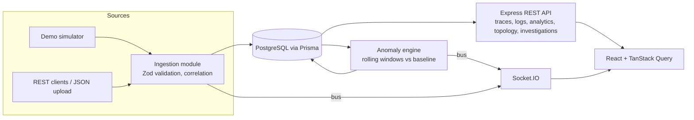

# Architecture

- **Correlation**: spans belong to a trace (`Trace.traceId` unique per environment); logs reference `traceId`/`spanId`; topology is a SQL self-join of child spans to parent spans in different services.
- **Anomaly rules** (`apps/api/src/modules/anomaly.ts`): `detect()` is pure and unit-tested; `runDetection()` loads current and baseline windows and de-duplicates open anomalies.
- **OpenTelemetry readiness**: the ingestion layer maps plain schemas to storage; an OTLP/HTTP adapter can translate OTLP spans into `TraceInput` without changing storage.
- **Demo isolation**: demo records carry `isDemo = true`.
